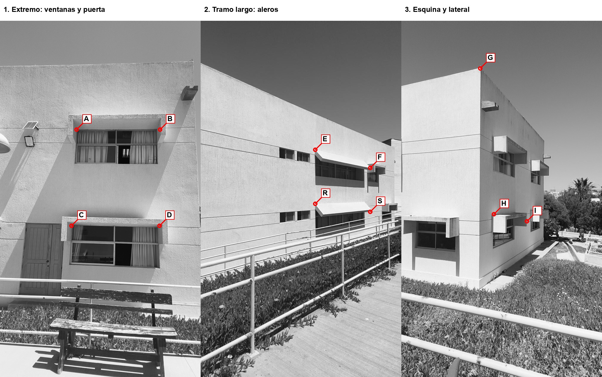

# Teología: visita de medición y calibración

**Actualización del 5-nov:** la cámara del **15T ya tiene una calibración candidata** y no necesita repetir su serie general. Para la visita del viernes 6-nov, con **teléfonos y cinta** confirmados por Gael, usar la [pauta de jornada adaptada al equipo](LocalizacionOffline-Jornada-2026-11-06.md). Esta hoja conserva el protocolo general y las propuestas A–I; sus puntos altos no son requisitos para medir con cinta. Falta calibración propia del Xiaomi 14 si se lo incorpora.

**Propósito:** medir escala y comprobar deformaciones en el mapa nuevo, además de reunir datos para calibrar las dos cámaras. El APK disponible registra imágenes; **no localiza con el mapa nuevo**. No hace falta repetir los recorridos completos. Llevar esta hoja y la [lámina de puntos](LocalizacionOffline-Controles-Teologia.jpg).

La lámina usa imágenes de construcción `143744`, cuadros `0011`, `0049` y `0116`, giradas solo para verlas. Cada círculo indica el punto físico propuesto; confirmar la esquina exacta, su cara y si está accesible y visible antes de medir. A–D están en los bordes superiores interiores de las dos ventanas del extremo; E/F y R/S en extremos de los aleros superior e inferior del tramo largo; G es la esquina exterior del techo, H e I son esquinas superiores de aleros en el lateral. **Son candidatos de control, no puntos 3D ya identificados ni medidas conocidas**: fotografiar cada punto de cerca y desde la vereda para resolver cualquier ambigüedad y, después, identificarlo en varias imágenes de construcción. Si una marca cae sobre un borde redondeado, sombra o queda ocluida, sustituirla por una esquina inequívoca cercana, dibujarla en la foto y anotar el cambio. No usar barandas, árboles, personas, lámparas ni bancos como controles.

## Equipo y registro

- Dos personas; cinta métrica y/o estación total/medidor láser apto para apuntar a los puntos y medir geometría 3D con precisión conocida. Un distanciómetro que solo mide desde su posición hasta la pared **no mide automáticamente la distancia entre dos esquinas remotas**. Priorizar equipo topográfico si no se puede apoyar la cinta o medir ambos extremos con seguridad. No subir ni cruzar barandas ni acceder a techos.
- Xiaomi 14 y Xiaomi 15T con el APK de captura ya usado y batería/espacio; papel cuadriculado rígido o tablero de calibración plano: **9 × 6 esquinas interiores**, cuadrados impresos sin escalado, toda la cuadrícula visible. Medir con regla varias longitudes de varias casillas y registrar tamaño real e incertidumbre; no asumir el tamaño impreso. Si el tablero está doblado o alguna esquina queda fuera, repetir esa vista.
- Copia de esta hoja y fotos, lápiz, fecha/hora y nombre del operador. Registrar instrumento, resolución, precisión declarada y método, distancia aproximada de apuntado, superficies reflectantes y estimación de incertidumbre **incluida identificación de puntos**, no solo la resolución del equipo. Para aspirar a evaluar 10–20 cm se recomienda buscar incertidumbre total de cada control claramente menor, por ejemplo **≤2 cm** si el equipo y acceso lo permiten; es una meta de medición, no precisión demostrada. Si no se logra, anotar el valor real y limitar las conclusiones.

## Medidas: ajuste y comprobación separados

Preferible: obtener coordenadas XYZ de todos los puntos en **un mismo sistema local** con estación total; registrar estaciones, cambios de estación, unidades y referencia, y repetir observaciones desde otra posición. La orientación absoluta no es necesaria para comparar la forma tras un ajuste por similitud. Antes de procesar, entregar por separado los puntos de ajuste A, B, C, E, F, G, H y los reservados D, R, S, I. Ajustar escala/pose solo con los de ajuste; evaluar los reservados después, sin cambiar el ajuste a partir de ellos. Estos controles distribuyen alto/bajo, extremo, tramo largo y esquina/lateral; ayudan a detectar diferencias de forma y profundidad que una sola longitud no revela. Si algunos no se pueden identificar o medir, conservarlos como faltantes y explicar cuál, no inventarlos.

Alternativa si solo hay cinta y existe acceso seguro: medir distancias rectas entre los extremos de las parejas siguientes. Anotar si la cinta toca ambos puntos; una medida entre proyecciones o siguiendo la pared no equivale a la distancia 3D. Las distancias sirven para escala y comprobaciones locales, pero **no determinan por sí solas un sistema 3D común ni validan toda la fachada**. No extrapolar las parejas que no sean físicamente accesibles. Si faltan enlaces entre sectores o profundidad, anotar que se requiere levantamiento topográfico.

| Uso | Pareja o punto | Valor y unidad | Incertidumbre ± | Instrumento/método, repetición, observaciones |
|---|---|---|---|---|
| Ajuste | A–B | ____ | ____ | ____ |
| Ajuste | A–C | ____ | ____ | ____ |
| Ajuste | E–F | ____ | ____ | ____ |
| Ajuste | G–H | ____ | ____ | ____ |
| Reservado | C–D | ____ | ____ | ____ |
| Reservado | R–S | ____ | ____ | ____ |
| Reservado | H–I | ____ | ____ | ____ |

Para XYZ usar una línea por punto en una hoja aparte: `ID, X, Y, Z, unidad, incertidumbre, estación, instrumento, observaciones`; dejar explícito cuáles son reservados. Repetir una o más mediciones y anotar ambas lecturas; si discrepan más que la incertidumbre prevista, investigar y conservar ambas. Fotografiar con una regla junto al punto solamente cuando sea accesible sin riesgo. No inferir distancia desde las etiquetas 10/15 m, GPS, Immersal ni poses de Unity.

## Calibración de cámara

Para **cada teléfono**, mantener la misma cámara principal, orientación vertical y configuración usada en los recorridos; no usar zoom digital. En el APK existente, Comenzar → cinco toques arriba a la izquierda → Equipo → Grabar; seleccionar cualquier etiqueta necesaria para habilitar la captura y anotar claramente que la sesión es `CALIBRACION`, no construcción de Teología. Usar barridos de 5 s; mover lentamente tablero o teléfono para obtener al menos 15–20 imágenes nítidas y diferentes, con el tablero completo ocupando zonas centrales y periféricas del sensor, varias inclinaciones y distancias. Si el seguimiento no permite capturar el tablero, hacerlo en un entorno con textura alrededor y conservar ese fallo; no inventar intrínsecos. Mantener el tablero plano y la medición de sus casillas.

El [tablero imprimible tamaño carta](../output/pdf/Tablero-calibracion-AncoRA-Carta.pdf) tiene 10 × 7 cuadrados y 9 × 6 esquinas interiores. Imprimir horizontal al 100 %, pegar sobre una superficie rígida sin tapar el patrón y medir el ancho de diez cuadrados y la altura de siete: el PDF indica 24 cm × 16,8 cm; registrar lo medido y volver a imprimir si las escalas horizontal y vertical difieren. Por teléfono, hacer tres barridos de 5 s para ajuste (centro, bordes y distintas inclinaciones), uno independiente para comprobación y dos con tablero fijo para movimiento suave y rápido. Anotar qué carpeta corresponde a cada uno. Se puede hacer en casa, con buena luz, sin repetir los recorridos del campus.

Hacer una segunda serie del mismo tablero para **comprobación reservada**, sin usarla en el ajuste de intrínsecos: posiciones y bordes distintos. Conservar los PNG originales y `intentos.jsonl`, identificar teléfono, cámara, cuadrícula y medición. Compararemos PINHOLE registrado contra calibración con distorsión y error en vistas reservadas, y verificaremos la convención de imagen sin girar. Un bajo error de tablero no demuestra por sí solo exactitud de la pose en movimiento.

Para investigar sincronía y orientación, con el tablero fijo hacer además una captura corta por teléfono con traslación y giro suaves, y otra con movimiento más rápido, manteniendo tablero completo y seguimiento. No usar sus poses como verdad: se comparará el movimiento óptico del tablero con las poses registradas. El grabador toma la pose de Unity en `LateUpdate`, pero asigna al campo `timestamp_pose_sensor` el tiempo del cuadro de cámara, **no un sello de tiempo medido de la pose**; estas capturas pueden revelar inconsistencia, no reconstruir exactamente el instante de pose. Si eso impide el uso multicuadro, habrá que instrumentar y validar el dispositivo antes de integrar.

## Consultas independientes, solo si queda tiempo

Con el Xiaomi 15T y/o 14, después de la medición, registrar barridos de cinco segundos desde posiciones accesibles al inicio, centro y otro extremo, sin cruzar barandas. Anotar teléfono, fecha, luz, ubicación aproximada y qué partes de fachada aparecen. Usar carpetas `barrido-…` nuevas, separadas de construcción, calibración y ajuste. Para una prueba física de precisión hará falta también medir de forma independiente la pose o posición de cámara y referencias visibles en cada consulta: una etiqueta de distancia no basta. Estas sesiones, si se inspeccionan para depurar, no serán una prueba final ciega; reservar otras nuevas para la evaluación final.

## Qué traer

Copia completa de cada carpeta `barrido-…` con PNG e `intentos.jsonl`, fotos de puntos con identificación, hoja de coordenadas/medidas separando ajuste y reservadas, detalles de instrumento y tablero, y notas de fallos/acceso. Esperar el fin del guardado y usar «Copiar grabaciones a Descargas». No hace falta APK nuevo para esta visita de medición/captura; los registros actuales ya demostraron exportación. El mapa seguirá en escala arbitraria hasta identificar los puntos, validar cámara, estimar escala y comprobar los controles reservados.
